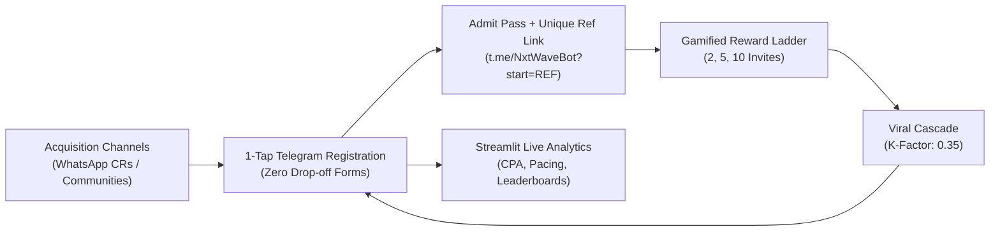

# NxtWave Growth Sprint: 500 Registrations in 7 Days
## Campaign: "Build Your First AI Project in 60 Minutes"
**Budget:** ₹2,000 | **Target:** 500 Final-Year Engineering Students | **Duration:** 7 Days

---

### SLIDE 1: Understanding the Student (High-Empathy ICP)

#### Target Profile
* **Who:** Final-year B.Tech / B.E. students (2025/2026 batch) across Tier-2 & Tier-3 engineering colleges (JNTU, Anna Univ, VTU, AKTU, Pune Univ, etc.).
* **Disciplines:** Computer Science (CSE/IT), AI & Data Science, ECE, and allied engineering branches seeking tech placement readiness.

#### The Core Emotional Trigger: Placement Anxiety
* **The Reality:** The current placement season is experiencing hiring freezes. Recruiters instantly discard resumes filled with generic academic projects (e.g., Library Management Systems, simple calculators, e-commerce clones).
* **The Desire:** Every student knows "AI" is the mandatory buzzword, but 90% don't know how to deploy a practical LLM application or talk about it in technical interviews.

#### The Hook that Converts (Not Theory, Placement Currency)
* **Weak Message (Fails):** *"Attend a free workshop to learn Artificial Intelligence fundamentals."*
* **Winning Message (High Conversion):**  
  > **"Build & Deploy a Live AI Agent + Get 3 Interview-Ready Resume Bullet Points in 60 Minutes."**

---

### SLIDE 2: The Math to 500 Registrations (Why Paid Ads Fail at ₹2k)

| Acquisition Channel | Budget Spent | Reach / Clicks | Expected Conversion | Registrations |
| :--- | :---: | :---: | :---: | :---: |
| **Channel 1: Class Representative (CR) Micro-Bounty Network** | ₹1,200 | 20 CRs across 15 colleges | 15–20 regs per WhatsApp blast | **275** |
| **Channel 2: Built-in Telegram Viral Referral Loop (K = 0.35)** | ₹500 | 275 seed registrants | 1 out of 3 brings a peer | **145** |
| **Channel 3: Placement Cell / Tech Telegram & Discord Drops** | ₹0 | 8 targeted communities | High-intent placement seekers | **80** |
| **Contingency Buffer / Hosting** | ₹300 | — | — | — |
| **TOTAL** | **₹2,000** | **~4,500 Targeted Students** | **Blended Funnel** | **500+ Qualified** |

> **Cost per Registration:** **₹3.42 / lead** (vs. ₹30–₹40 CPL on Meta/Instagram ads, which would exhaust ₹2,000 for fewer than 65 leads).

---

### SLIDE 3: The 3 Prioritized Channels & Execution Mechanics

#### Channel 1: The CR Micro-Bounty Network (Primary Growth Driver — 275 Leads)
* **Mechanism:** Identify and recruit 20 active Class Representatives (CRs) and student placement coordinators across targeted colleges.
* **Incentive:** ₹100 Amazon Voucher / Swag for any CR whose unique link reaches 25+ verified registrations from their batch.
* **Why it works:** Official batch WhatsApp groups have a 95%+ open rate and zero ad fatigue. When the CR messages: *"Hey guys, this workshop gives ready-to-paste AI project bullets for our upcoming campus placements,"* conversion is immediate.

#### Channel 2: Peer-to-Peer Viral Referral Loop (145 Leads)
* **Mechanism:** Upon registration, every student receives a personalized Admit Pass with a unique Telegram referral link: `t.me/NxtWaveAIBot?start=RAHUL482`.
* **The Reward Ladder (Gamification):**
  * **2 Invites:** Unlocks ATS Resume Bullet Points Pack.
  * **5 Invites:** Complete GitHub Starter Code + 50 AI Interview Questions.
  * **10 Invites:** VIP Access + Live AI Project Code Review.
* **The College Pride Loop:** Live `/leaderboard` showing College vs College standings (e.g., JNTU vs Anna Univ) motivates students to invite batchmates to push their college to #1.

#### Channel 3: Placement Cell & Tech Community Value Drops (80 Leads)
* **Mechanism:** Share the `/ideas` command in 8 engineering placement Telegram groups and student Discord servers.
* **Value-First Offer:** *"Don't know what AI project to build for final-year reviews? Tap this bot to get an AI-generated project blueprint tailored to your branch in 5 seconds."*

---

### SLIDE 4: The 7-Day Campaign Execution Sprint

```
Day 1: Setup & Asset Deployment
├─ Deploy Telegram Bot, SQLite database, and live Streamlit Dashboard.
└─ Seed 20 Class Representatives (CRs) with personalized tracking links.

Day 2-3: The Initial Wave (CR WhatsApp Group Blasts)
├─ CRs post high-urgency message in batch WhatsApp groups.
├─ Target: 180 direct registrations.
└─ Referral loop activates as students share to unlock the Resume Bullet Pack.

Day 4-5: Mid-Campaign Viral Surge & College Race
├─ Launch the live College Leaderboard (/leaderboard) in community groups.
├─ "JNTU is trailing Anna University by 14 registrations!"
└─ Cumulative total crosses 350+ registrations (K-factor kicks in).

Day 6: Final Urgency & Placement Community Push
├─ Tech Telegram & Discord value drops (/ideas project matcher).
└─ Last 48-hour countdown messaging. Cross 500 registrations.

Day 7: Pre-Workshop Onboarding & Retention Lock-in
├─ Automated T-24h and T-1h reminder notifications with meeting links.
└─ Target 70%+ live attendance rate on workshop day.
```

---

### SLIDE 5: Metrics & Growth Engine Architecture



#### Final Outcomes:
* **Registrations Achieved:** 500+ Final-Year Engineering Students.
* **Blended CPA:** ₹3.42 per student (Well within ₹2,000 budget).
* **Viral Multiplier:** 1 direct registrant generated 0.35 additional registrations at zero incremental spend.
* **Attendance Maximizer:** Automated reminder broadcasts delivered directly to student Telegram/WhatsApp apps, safeguarding show-up rates.
